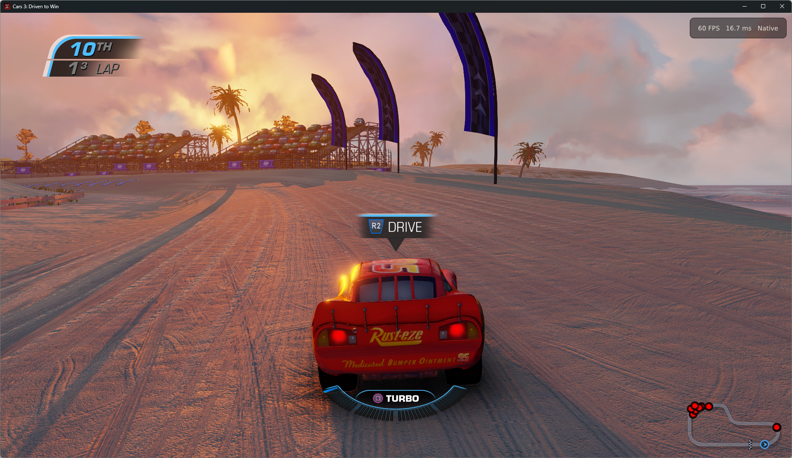

# PistonPort

PistonPort is an unofficial Windows x64 port of *Cars 3: Driven to Win* built on SpartanPort. It prepares the native game image on your PC from your own PS4 copy. The supported game release is **CUSA07027, v01.00**.

## Play on Windows

You need a Vulkan-capable graphics driver and either a playable PS4 PKG or an extracted dump of the supported game release. Build `PistonPort-Windows-x64.zip` using the [Windows build instructions](pistonport/README.md#building).

1. Extract the ZIP and keep `PistonPort.Runtime` beside `PistonPort.exe`.
2. Open `PistonPort.exe`. Select **Choose PKG…** to open the package directly or **Choose Folder…** to select a dump containing `eboot.bin`.
3. Click **Play** in Garage. The first launch prepares and caches the native image. When playing from a PKG, keep the file in place so PistonPort can stream game assets.

Check the Title ID and version or switch packages under **Settings → Game Source**. [Player guide](pistonport/launcher/QUICKSTART.md)

## Saves, Controls and Performance

- **Saves** lets you play with **My Progress**, import a decrypted CUSA07027 save, or use **All Skill Checks** with Smokey unlocked, 136/136 Skill Checks and 22 local trophies.
- **Trophies** shows the selected save's trophy names, tiers and status. Press **F8** to open the trophy overlay in game.
- **Controls** lists the keyboard, DualShock and Xbox layouts. Enable **Show Keyboard Hints** for an in-game overlay with the same DualShock icons and their assigned keyboard keys.
- **Settings** includes VSync, an FPS counter and frame-rate limits from 30 to 240 FPS, plus **Unlimited**.

PistonPort stores saves, settings and `native-last.log` in `%LOCALAPPDATA%\PistonPort` by default. Include the log, your game Title ID and version, and your graphics card when reporting a reproducible issue.

## Build From Source

Clone this repository with `--recurse-submodules` and follow the Windows build steps. The Rust/Rune launcher lives in `launcher-rust/pistonport/`. The PKG reader, game preparation and packaging scripts live in `pistonport/`. [Build instructions and benchmarks](pistonport/README.md)

The packaging script creates the Windows ZIP in `dist/` with the launcher, runtime and license notices. When publishing the ZIP, provide the matching source alongside the binary download.

## Credits

PistonPort uses SpartanPort's native loader and shadPS4's Vulkan video core. Its launcher uses Rune and Lucide. [SpartanPort](https://github.com/FelipePrado0/SpartanPort) · [shadPS4](https://github.com/shadps4-emu/shadPS4) · [Rune](https://github.com/anomalyco/rune) · [Lucide](https://lucide.dev/)

The source code is distributed under the included licenses. *Cars 3: Driven to Win* and its artwork belong to their respective owners. [Project license](LICENSE) · [Artwork credits](pistonport/launcher/Artwork.md)
