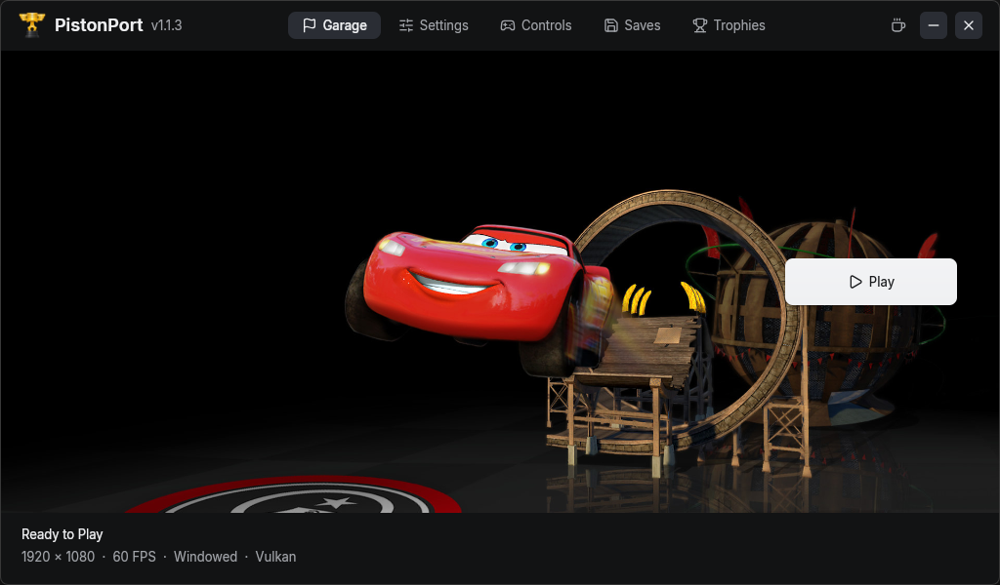

# PistonPort

An unofficial native Windows x64 port of *Cars 3: Driven to Win* (PS4).

[**Download for Windows (Latest)**](https://github.com/afkarxyz/PistonPort/releases/latest/download/PistonPort-Windows-x64.zip)

> **No game files are included.** You need a dump from your own PS4 (tested: CUSA07027, version 01.00). This project is not affiliated with or endorsed by Disney/Pixar, Warner Bros. Interactive Entertainment, Avalanche Software, or Sony Interactive Entertainment. *Cars 3: Driven to Win* is a trademark of Disney/Pixar.

## Getting Started

You need a Vulkan-capable graphics driver and a playable PKG or extracted game folder. Extract the entire ZIP, open `PistonPort.exe`, select your game source, and click **Play**.

[Player Guide](pistonport/launcher/QUICKSTART.md) · [Technical Notes & Build](pistonport/README.md) · [Settings Screenshot](docs/images/pistonport/PistonPort-Settings.png) · [Gameplay Screenshot](docs/images/pistonport/PistonPort-Gameplay.jpg) · [Ultrawide Screenshot](docs/images/pistonport/PistonPort-Ultrawide.jpg)

## Credits

PistonPort uses SpartanPort’s loader, shadPS4’s Vulkan renderer, and Rune for the launcher. [SpartanPort](https://github.com/FelipePrado0/SpartanPort) · [shadPS4](https://github.com/shadps4-emu/shadPS4) · [Rune](https://github.com/anomalyco/rune) · [License](LICENSE)
